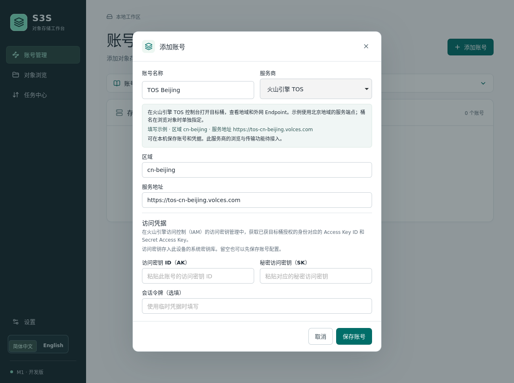

# S3S

S3S 是用 Go、Wails 3、Vue 3 和 SQLite 构建的对象存储桌面客户端。当前开发分支在 M0 桌面工程上接入了 AWS S3 和 Cloudflare R2 的分页浏览、可恢复的上传和下载。支持本机多账号管理、任务记录、中英切换和语言包导入。构建和普通测试无需云账号。远端复制与删除、OSS/TOS 传输及通用 S3 适配仍在路线图中。

## 第一次添加存储账号

打开桌面端的 **账号管理 → 添加账号**。先起一个自己容易识别的账号名称，再选择服务商。区域和端点取自桶所在地域。公开端点只填服务地址，桶名和对象 Key 在浏览时单独选择。访问凭据使用服务商签发的密钥对，网页登录密码只在服务商的登录页使用。

以**火山引擎 TOS 的北京桶**为例，账号名称可填 `TOS Beijing`。选择「火山引擎 TOS」，点击「填入示例区域和服务地址」，会填入 `cn-beijing` 和 `https://tos-cn-beijing.volces.com`。若桶在其他地域，改用该桶控制台显示的值。在同一表单填写访问密钥 ID（AK）和秘密访问密钥（SK）。使用 STS 临时凭据时，一并填写 Security Token。点击「保存账号」即可在列表中找到它。当前版本可保存 TOS 账号及凭据，桶浏览和传输将在 M2 接入。[火山引擎官方地域与域名对照](https://github.com/volcengine/ve-tos-golang-sdk/blob/1392f181ac7823519e5c83089b2217de21653830/tos/consts.go#L37) · [TOS 凭据字段](https://github.com/volcengine/ve-tos-golang-sdk/blob/1392f181ac7823519e5c83089b2217de21653830/tos/credential.go#L11)



| 服务商 | 区域与端点示例 | 访问凭据 | 当前可用 |
| --- | --- | --- | --- |
| AWS S3 | 新加坡桶填 `ap-southeast-1`。端点可以留空，由 S3S 生成 `https://s3.ap-southeast-1.amazonaws.com`。区域留空时使用 `us-east-1`。 | IAM 访问密钥的 Access Key ID 和 Secret Access Key。临时凭据另填 Session Token。 | 保存账号、浏览、上传、下载。[AWS S3 区域端点](https://docs.aws.amazon.com/general/latest/gr/s3.html) |
| Cloudflare R2 | 区域填 `auto`。从 R2 控制台复制 S3 API 端点，通常为 `https://<ACCOUNT_ID>.r2.cloudflarestorage.com`，将占位符替换成自己的账号 ID。辖区桶使用控制台显示的对应辖区端点。 | 创建 R2 API 令牌后，复制页面显示的 Access Key ID 和 Secret Access Key。临时凭据另填 Session Token。 | 保存账号、浏览、上传、下载。[Cloudflare R2 凭据与端点](https://developers.cloudflare.com/r2/api/tokens/) |
| 阿里云 OSS | 杭州桶填 `cn-hangzhou` 和 `https://oss-cn-hangzhou.aliyuncs.com`。 | 使用已获桶权限的 RAM 用户 AccessKey ID、AccessKey Secret，或 STS 临时凭据及其 SecurityToken。 | 保存账号及凭据。云操作待接入。[阿里云 OSS 开发指南](https://github.com/aliyun/alibabacloud-oss-go-sdk-v2/blob/d3474aa038242301669f48b1f08d1b15cdf7c324/DEVGUIDE-CN.md) |
| 通用 S3 兼容服务 | 按服务商给出的签名区域和端点填写。例如 `us-east-1`、`https://s3.example.com`，后者是占位域名。 | 使用该服务签发的访问密钥对。如服务发放临时令牌，一并填写。 | 保存账号及凭据。云操作待接入。 |

可以先留空密钥，只保存公开配置。打开「编辑账号」后，已存密钥不会回显。保留相同服务商、区域和端点并留空凭据，即可继续使用原有密钥。更换端点或区域时需为新配置填写对应的密钥。凭据进入当前用户的系统密钥库：Windows 使用凭据管理器，macOS 使用钥匙串，Linux 需要会话 D-Bus 上可用且已解锁的 Secret Service。若提示账号已保存而凭据写入失败，可在同一账号上重试。

## 浏览和传输（AWS S3、Cloudflare R2）

1. 在「对象浏览」页面选择账号。可以列出桶，也可直接输入已知桶名，再进入前缀或翻页。只授权单个桶的身份可直接打开该桶。浏览与下载分别需要相应的列表和对象读取权限。
2. 下载时使用系统对话框选择一个尚未存在的目标文件。目标目录需可写、有足够空间，并支持创建硬链接。Go 引擎在目标目录内写临时文件，完成后发布到所选路径。目标文件已存在会报告冲突。
3. 在任务中心暂停或继续下载。程序意外退出后，重新打开相同用户配置，选中中断任务并手动继续。保留同目录的临时文件。恢复时会重新检查对象身份及已保存的数据块。
4. 上传时先进入目标桶，选择上传，核对账号、桶和完整对象 Key，再通过系统对话框选择本地文件。Key 按输入原样使用。入队前会读取源文件计算摘要，较大文件需要等待。可停止准备，已经入队的任务可在任务中心查看。已有同名对象会产生冲突。上传凭据需要相应前缀的对象写入、读取、列举分片和中止权限。AWS 还需允许该桶的 ListBucket，使 HEAD 能确认目标 Key 尚不存在。
5. 在任务中心暂停或继续上传。恢复时保留同一个本地源文件。取消上传会清理该任务已记录的远端会话。清理失败时任务会保留，修复连接或权限后可重试。

要验证**第一次上传和下载**，可以准备一个内容为 `你好，S3S` 的 `hello.txt`。在「对象浏览」选择已保存的 AWS 或 R2 账号，输入自己已有且允许读写的测试桶名（例如将 `team-example-<自选后缀>` 换成实际桶名），点击「打开存储桶」。在桶内选择「上传文件」，完整 Key 输入 `s3s-test/hello.txt`，点击「选择文件并上传」并选中该文件。等「任务中心」显示完成后，回到桶中刷新，进入 `s3s-test/`，将对象下载到一个新文件并打开，核对文字是否一致。此示例会实际写入该测试桶。如仅查看账号表单和填写示例，可直接打开「添加账号」。

## 切换语言

在侧栏「设置」下方直接点 **简体中文** 或 **English** 即可切换。当前页面保留，进行中的传输继续运行。需要其他语言时，打开 **设置 → 更多语言**，导入 JSON 语言包或选用已导入的语言。缺少的词条使用英语显示。文件格式见[语言包示例](docs/ARCHITECTURE.md#语言与错误)。

## 网页版 Codex 开发

在云端打开 `Cdners/S3S`，进入仓库根目录。当前实例为 Debian 13.7、Linux x86_64，提供 Docker、Node 24.22.3 和 npm 11.19.1。宿主的 `/usr/bin/go` 不是 Go 编译器。使用项目脚本准备固定版本工具链和带 GTK 4 / WebKitGTK 6 的 Linux 构建容器。

```bash
cd /workspace/S3S
bash scripts/cloud-linux.sh setup
export npm_config_cache=/workspace/.s3s-tools/npm-cache
bash scripts/check.sh frontend
bash scripts/cloud-linux.sh run bash scripts/check.sh go
bash scripts/cloud-linux.sh run bash scripts/build.sh
```

需要 Wails CLI 时，在同一云端容器执行 `bash scripts/cloud-linux.sh run go install github.com/wailsapp/wails/v3/cmd/wails3@v3.1.0`，再执行 `bash scripts/cloud-linux.sh run /tools/gopath/bin/wails3 version`。实测输出为 `v3.1.0`，与 Go 模块和前端 runtime 一致。常规构建直接使用固定的 Go 模块。

前端检查通过锁文件安装依赖，校验语言资源并做 TypeScript 检查和生产构建。Go 检查验证模块、运行 vet 和实际测试。最终归档位于 `dist/`，包含平台、架构与 Git commit。含未提交改动的本地构建另加 `-dirty` 后缀。先构建前端，再编译 Go，确保 WebView 资源嵌入可执行文件。

使用云端预装的 Python Playwright 和 Chromium 运行 `python3 tests/ui/preview.py`，可复验浏览器预览中的双语导航、语言包导入、错误提示和回退。

在同一云机上，可从打包产物启动实际 Linux 桌面程序并自动操作窗口。测试使用独立的临时用户数据，依次打开页面、保存连接、切换语言，结束进程后重新启动，并核对保存结果。

```bash
stage=$(mktemp -d)
revision=$(git rev-parse HEAD)
if [ -n "$(git status --porcelain --untracked-files=normal)" ]; then revision="$revision-dirty"; fi
tar -xzf "dist/s3s-linux-amd64-$revision.tar.gz" -C "$stage"
bash tests/ui/linux-container.sh "$stage/S3S"
```

连接元数据及任务状态保存在系统的用户配置目录下的 `S3S/workspace.sqlite3`。SQLite 保存账号名称、服务商、区域和端点。凭据单独存入所选连接对应的系统凭据库条目。更改服务商、区域或端点后，为新配置设置凭据。界面中的语言选择、导入的语言包保存在本机 WebView 用户数据中。

## 工程入口

| 路径 | 用途 |
| --- | --- |
| `main.go`、`workspace.go` | 桌面窗口、资源嵌入、Go 与界面的元数据接口 |
| `internal/core/` | 独立于 GUI 的连接、状态、传输选项、能力与结构化错误 |
| `internal/s3client/`、`internal/vault/` | AWS/R2 协议请求及连接隔离的系统凭据管理 |
| `internal/transfer/` | 条件范围下载、分片上传、源文件和远端对象核对、暂停与恢复、取消清理 |
| `internal/store/` | SQLite 迁移、状态转换和分片检查点 |
| `frontend/src/` | Vue 工作区、语言包解析与独立翻译资源 |
| `scripts/`、`.github/workflows/` | 云端复现脚本、原生构建与开发产物 |

产品范围见 [产品规格](docs/PRODUCT_SPEC.md)。开发前请查阅 [开发约定](AGENTS.md)、[架构与固定版本](docs/ARCHITECTURE.md)、[路线图](docs/ROADMAP.md) 和 [当前状态](docs/STATUS.md)。跨平台产物由 GitHub Actions 构建，平台检查和产物说明见 [测试](docs/TESTING.md) 与 [发行流程](docs/RELEASING.md)。
